<h1 align="center">Passo</h1>

<p align="center">
  <strong>Aprende piano y guitarra con corrección al instante.</strong><br />
  Toca, Passo te escucha por el micrófono y te dice al momento qué salió bien y qué no.<br />
  <em>Paso a paso: no avanzas hasta que lo dominas.</em>
</p>

<p align="center">
  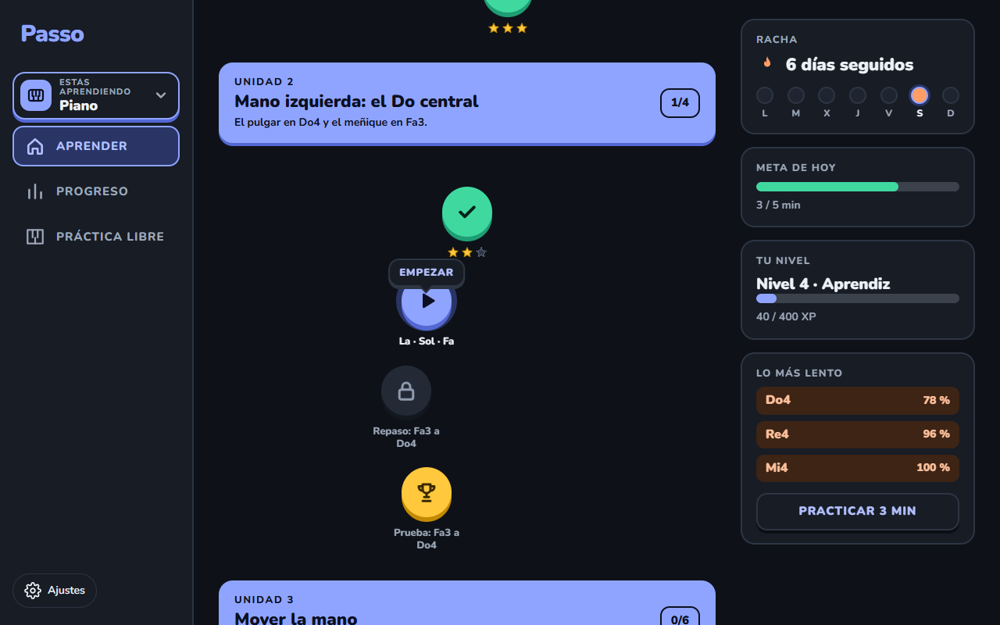
</p>

<p align="center">
  React 19 · TypeScript · Vite · Clean Architecture · Vitest · Playwright<br />
  Sin cuentas, sin nube, sin anuncios: todo corre y se guarda en tu navegador.
</p>

---

## Contenido

- [Qué es](#qué-es)
- [Recorrido con capturas](#recorrido-con-capturas)
- [Qué puedes hacer hoy](#qué-puedes-hacer-hoy)
- [Empezar](#empezar)
- [Cómo tocas: micrófono, MIDI o teclado del PC](#cómo-tocas-micrófono-midi-o-teclado-del-pc)
- [Guitarra](#guitarra)
- [Direcciones y parámetros](#direcciones-y-parámetros)
- [Cómo funciona por dentro](#cómo-funciona-por-dentro)
- [Estructura del proyecto](#estructura-del-proyecto)
- [Calidad y pruebas](#calidad-y-pruebas)
- [Estado y hoja de ruta](#estado-y-hoja-de-ruta)
- [Documentación](#documentación)

## Qué es

Quien aprende con videos y cursos termina tocando lo que ya sabe, y nadie le corrige en el momento.
Passo hace lo contrario: **te muestra qué tocar, te escucha y te corrige al instante**, y te lleva
a practicar justo lo que más te cuesta.

- **Corrección inmediata.** Cada nota se evalúa al sonar: acierto, error (con «era Sol, tocaste Fa,
  una tecla a la izquierda») o duda del micrófono, que no cuenta como error.
- **Funciona con el instrumento que ya tienes.** El micrófono del portátil es la entrada principal:
  no hace falta un piano con USB-MIDI. El audio se analiza en tu equipo; **no se graba ni se envía**.
- **Un juego, no un examen.** Camino de unidades y lecciones cortas (2–4 minutos), estrellas,
  experiencia, racha de días y una meta diaria.
- **Dos instrumentos en una sola app.** Piano y guitarra comparten racha y experiencia, pero cada uno
  tiene su camino, sus estrellas y sus notas más flojas.

## Recorrido con capturas

### El camino y la ventana de la lección

El camino se abre centrado en tu lección. Al tocar un nodo sale una ventana con lo que vas a tocar,
cuánto hay que acertar y las estrellas que llevas; no entras de golpe.

<table>
  <tr>
    <td width="50%">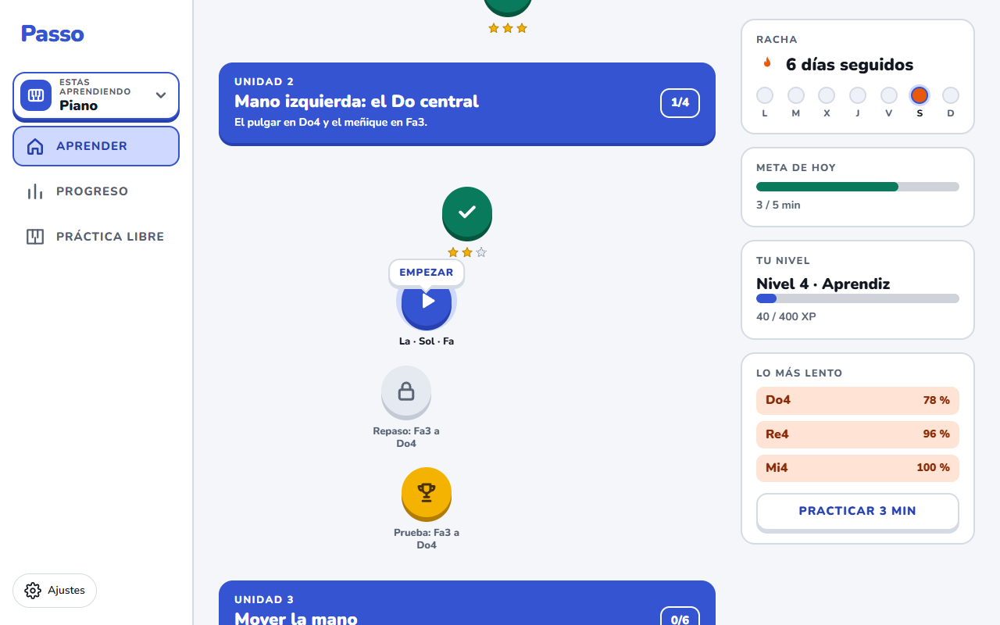</td>
    <td width="50%">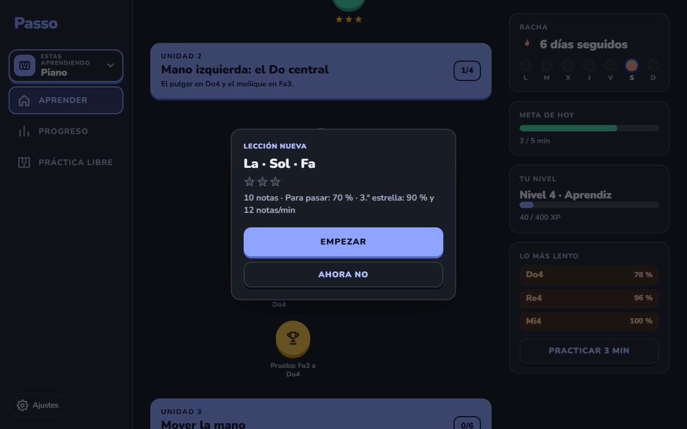</td>
  </tr>
  <tr>
    <td align="center"><sub>Tema claro, oscuro o el del sistema.</sub></td>
    <td align="center"><sub>«Empezar» o «Ahora no»; Esc también la cierra.</sub></td>
  </tr>
</table>

### La lección: corrección al instante

Cada objetivo muestra **la nota, la mano y el dedo**, las dos notas siguientes **cayendo** sobre el
teclado y la **mano fantasma** debajo. Si te equivocas, Passo te dice cuál era y hacia dónde te
desviaste; la tecla correcta queda marcada.

<table>
  <tr>
    <td width="50%">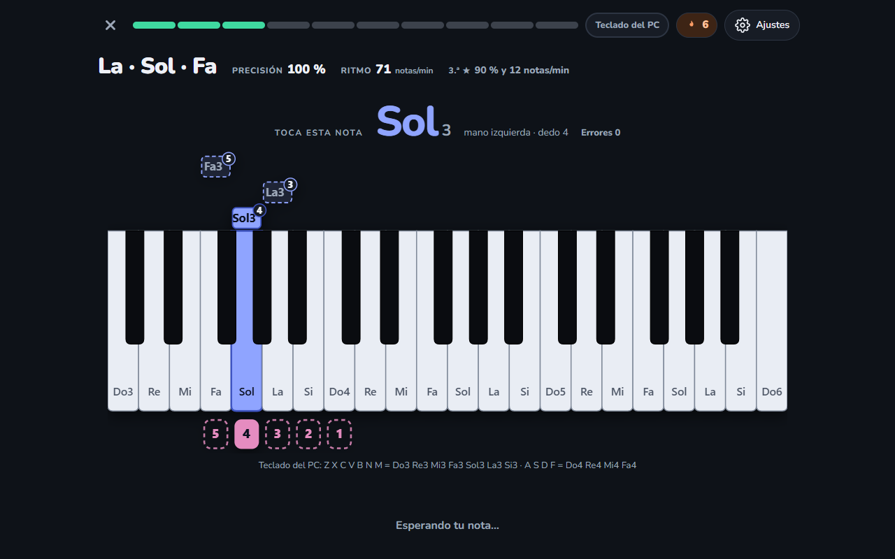</td>
    <td width="50%">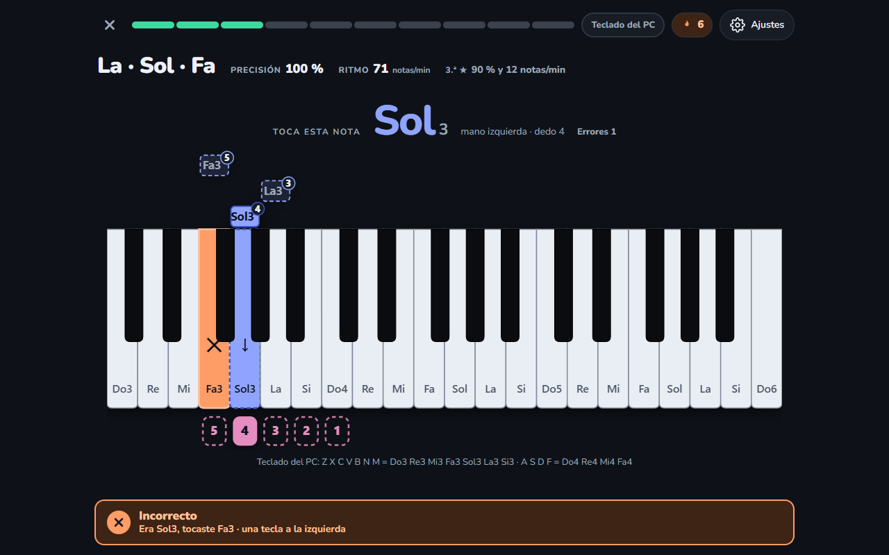</td>
  </tr>
  <tr>
    <td align="center"><sub>Nota, mano, dedo, cascada y ritmo en vivo.</sub></td>
    <td align="center"><sub>«Era Sol3, tocaste Fa3 · una tecla a la izquierda».</sub></td>
  </tr>
</table>

### Escucha por micrófono

Passo oye tu piano o tu guitarra, mide el ruido de la sala, sigue la nota que suena y la compara con la
pedida. La barra muestra el nivel y lo que oye («Oigo: Re4»).

<p align="center">
  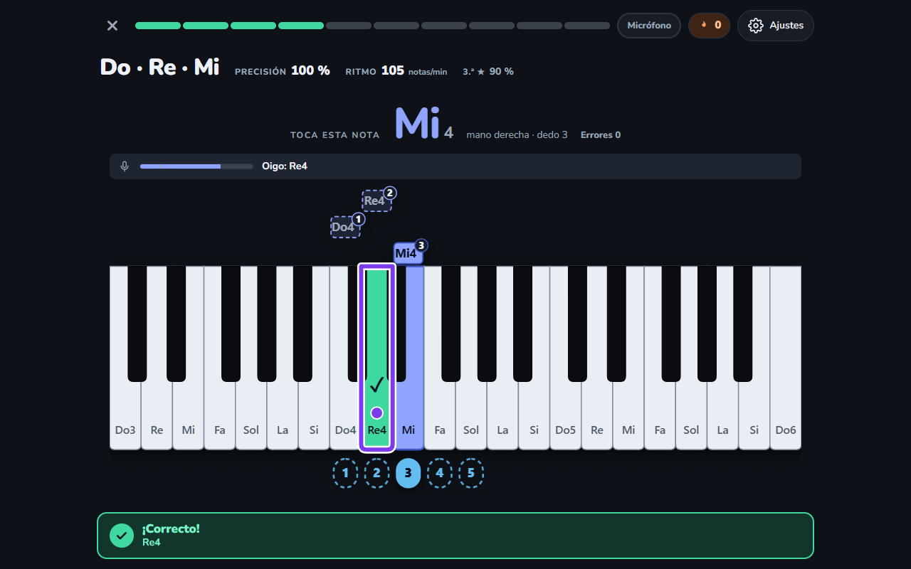
</p>

### Resultado, estrellas y progreso

Cada lección da hasta **3 estrellas**. Con ≥ 70 % de precisión se pasa; la tercera pide como máximo un
fallo y el ritmo marcado. Al final ves qué fue lo que más costó. En **Progreso** tienes tu nivel, medias,
la curva de precisión y el **mapa de tu teclado**: qué teclas aciertas a la primera y cuáles no.

<table>
  <tr>
    <td width="50%">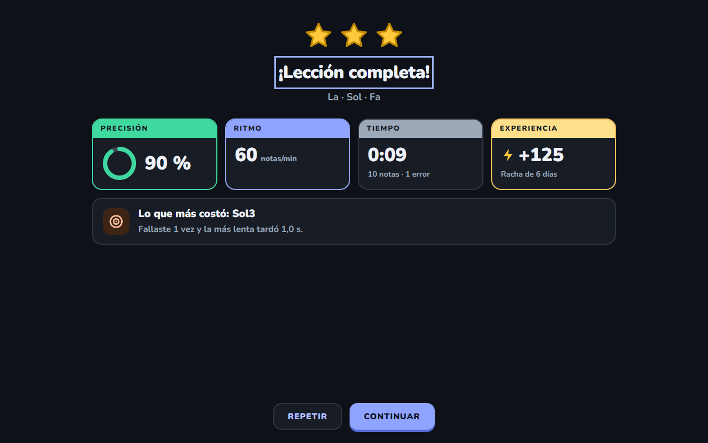</td>
    <td width="50%">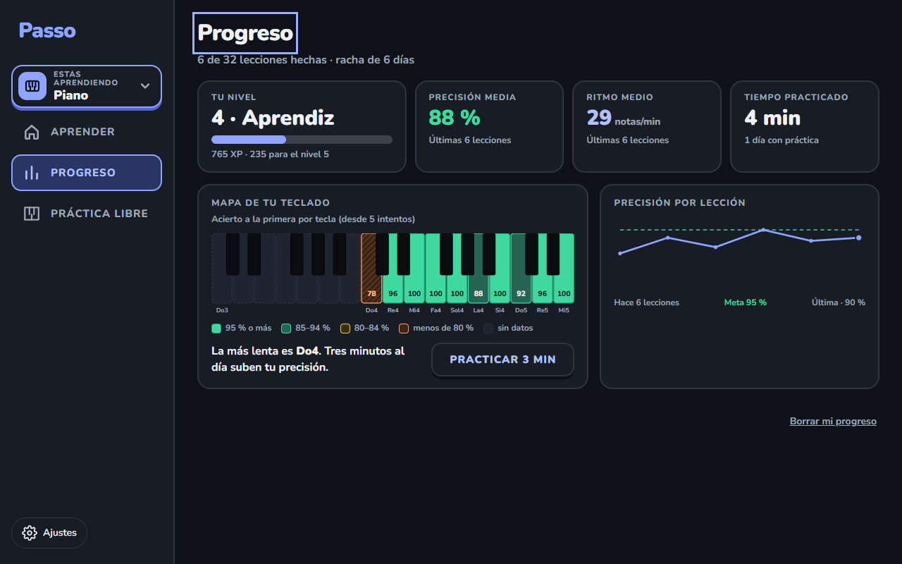</td>
  </tr>
</table>

### Terceras y acordes

Más allá de las notas sueltas hay terceras y acordes de tres notas, con la mano y los dedos 1-3-5 en
cada uno. Con micrófono necesitan la **beta «Oír varias notas a la vez»**; con piano MIDI o teclado del
PC funcionan siempre.

<p align="center">
  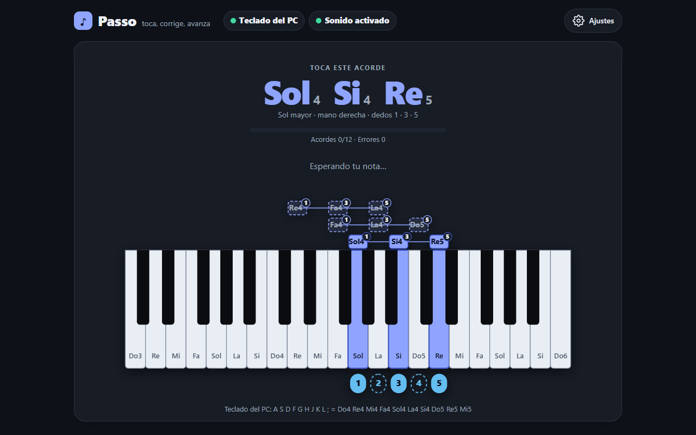
</p>

### Guitarra

El chip **«Estás aprendiendo»** abre la lista **Mis instrumentos** (pensada para que quepan más). La
guitarra tiene su propio camino, un **mástil** que dice cuerda, traste y dedo, y un **afinador**. El
acento de color pasa a violeta para que siempre sepas en qué instrumento estás.

<table>
  <tr>
    <td width="50%">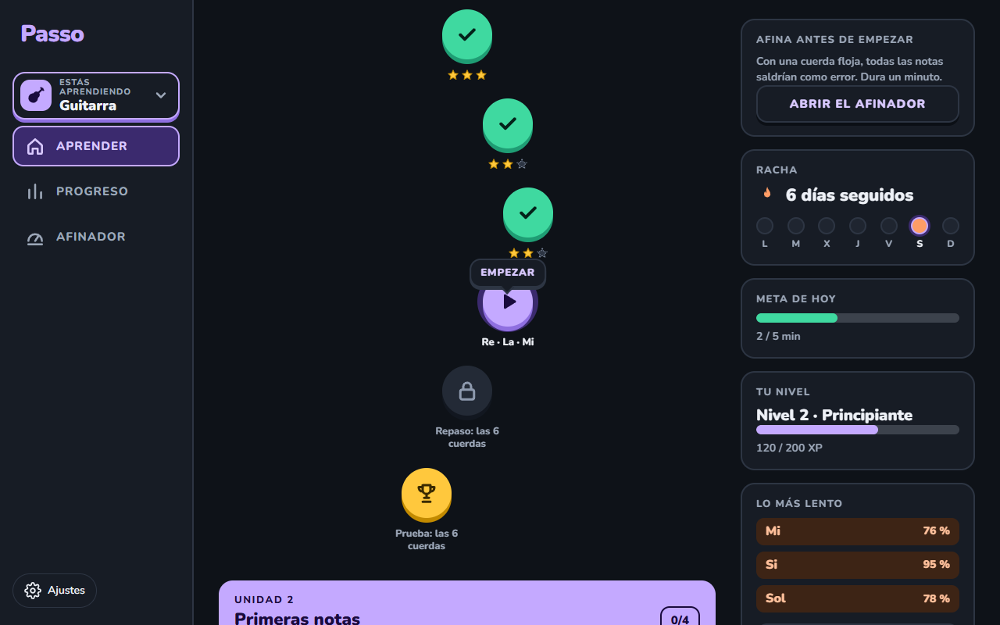</td>
    <td width="50%">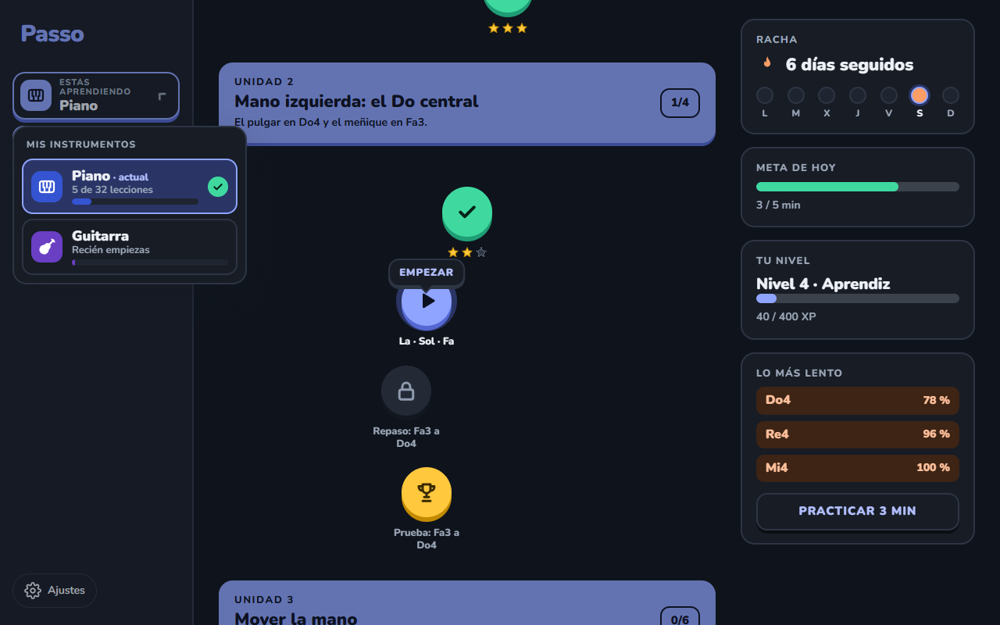</td>
  </tr>
  <tr>
    <td width="50%">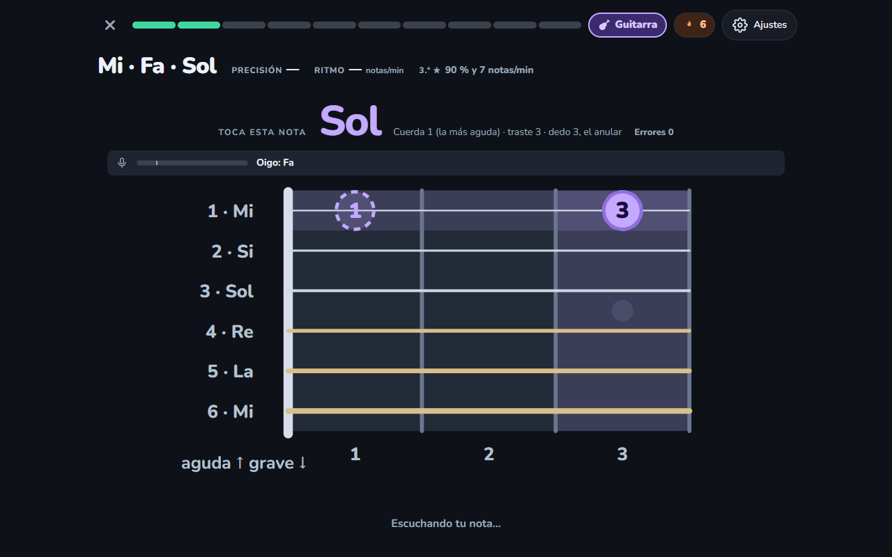</td>
    <td width="50%">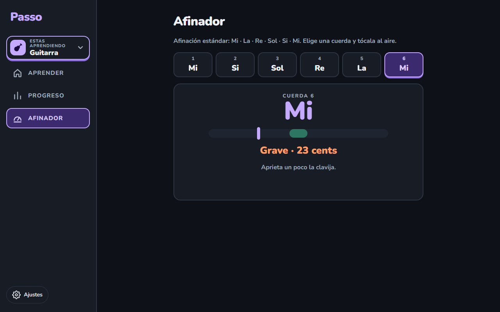</td>
  </tr>
</table>

### En el móvil

Cabe en una pantalla de 320 px sin desplazamiento horizontal: barra inferior, cabecera con el selector
de instrumento y la ventana de la lección como hoja que sube desde abajo.

<table>
  <tr>
    <td align="center">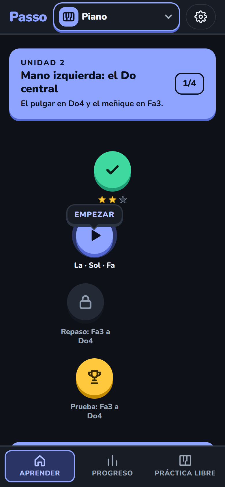</td>
    <td align="center">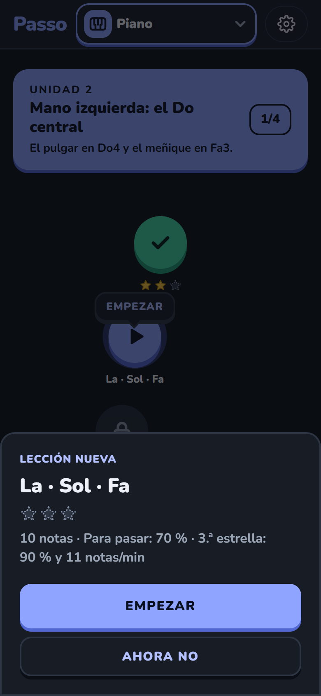</td>
    <td align="center">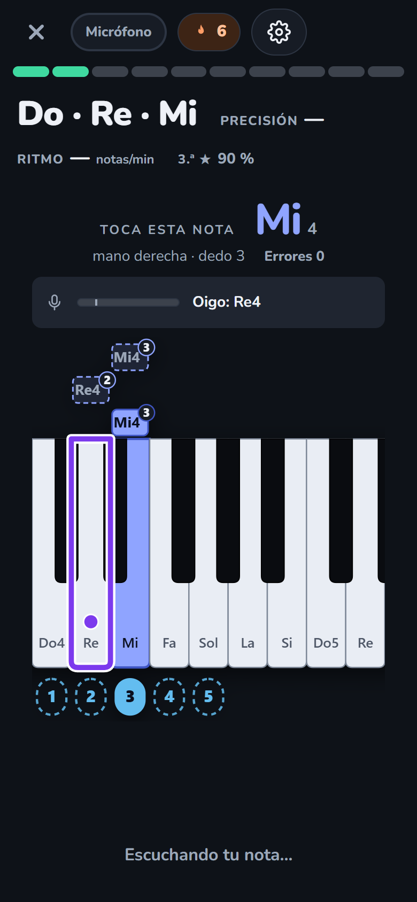</td>
    <td align="center">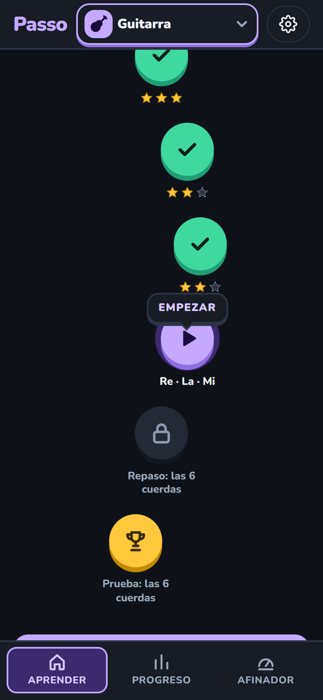</td>
  </tr>
</table>

> Las capturas son de la propia aplicación y salen de una prueba (`tests/e2e/readme.spec.ts`) con un
> micrófono **simulado**: se regeneran con un comando, ver [Calidad y pruebas](#calidad-y-pruebas).

## Qué puedes hacer hoy

| | |
|---|---|
| **Camino de piano** | 6 unidades y 32 lecciones: mano derecha (Do a Sol), mano izquierda, mover la mano, notas de acorde, las dos manos y, opcional, terceras y acordes |
| **Camino de guitarra** | 3 unidades y 14 lecciones: cuerdas al aire, primeras notas y todas las cuerdas hasta el traste 3 (17 notas naturales, de Mi2 a Sol4) |
| **Lecciones** | Nueva, repaso y prueba; hasta 3 estrellas; «saltar con prueba» (≥ 2 estrellas abre la unidad entera) |
| **Repaso de puntos débiles** | «Practicar 3 min» arma una lección al momento con las notas que más te cuestan |
| **Juego** | Experiencia, niveles, racha de días (con un día de descanso por semana) y meta diaria de 5 minutos |
| **Progreso** | Mapa de calor del teclado, curva de precisión, notas que más cuestan por instrumento |
| **Afinador de guitarra** | Eliges la cuerda; dice «Grave», «Aguda» o «Afinada» con los cents, y avisa si casi no oye |
| **Práctica libre** | La pantalla de siempre: notas, terceras o acordes, a tu nivel y con la ayuda que elijas |
| **Ajustes** | Entrada (micrófono, MIDI o teclado del PC), ejercicio y nivel, notación Do Re Mi o C D E, ayuda y tema. Se recuerdan |
| **Accesibilidad** | Contraste AA comprobado por pruebas, nada depende solo del color, navegación con teclado, anuncios para lector de pantalla y respeto de «reducir movimiento» |

## Empezar

Necesitas **Node ≥ 22.13** y un navegador moderno (Edge o Chrome; el micrófono pide `localhost` o HTTPS).

```bash
npm install
npm run dev
```

Abre la dirección que muestre la terminal (normalmente <http://localhost:5173>). La primera vez:

1. Elige cómo vas a tocar en **Ajustes → Cómo toco** (por defecto, micrófono).
2. Toca una lección del camino y pulsa **Empezar**.
3. Con micrófono, pulsa **Activar micrófono**: el navegador pide permiso, Passo mide el ruido de la
   sala y, cuando dice que escucha, empiezas. El micrófono **nunca se enciende solo** y se apaga al salir.

Sin piano a mano, prueba con el teclado del PC: abre <http://localhost:5173/?pc#/practica> y toca con
las teclas `A S D F G H J K L ;` (mano derecha, de Do4 a Mi5) o `Z X C V B N M` (mano izquierda, de Do3 a Si3).

## Cómo tocas: micrófono, MIDI o teclado del PC

| Entrada | Para qué | Notas |
|---|---|---|
| **Micrófono** | La principal: piano acústico, teclado sin USB y guitarra | Una nota a la vez. Terceras y acordes, solo con la beta «Oír varias notas a la vez» |
| **Piano MIDI** | Si tu piano tiene USB-MIDI | Exacto, con velocidad y acordes completos. Web MIDI no existe en Safari |
| **Teclado del PC** | Probar sin instrumento y desarrollar | Hace de piano; no hay guitarra con teclado |

El micrófono es una **escucha activa**: mide el ruido de la sala, detecta el ataque de cada nota, calcula
su altura (detección McLeod propia), aprende cuánto se desvía tu instrumento y marca con qué seguridad
oyó. Una nota dudosa nunca cuenta como error. Los detalles y lo medido están en
[docs/fases/fase-1.md](docs/fases/fase-1.md) y [docs/convenciones.md](docs/convenciones.md).

## Guitarra

- **Se juzga el nombre de la nota, no la octava.** La guitarra se escribe una octava por encima de como
  suena y el micrófono suele leer mal las cuerdas graves; así que el Mi de la cuerda 6 y el de la 1 cuentan
  igual. El mástil te dice dónde tocarlo (cuerda, traste y dedo).
- **Afina primero.** Con una cuerda floja todas las notas saldrían como error; el camino te lo recuerda y
  el afinador está a un toque. Sostiene ±5 cents durante 600 ms para dar «Afinada».
- **Solo con micrófono**, en afinación estándar y notas naturales hasta el traste 3.
- **Pronto:** arpegios y acordes, tablatura y la canción «Mi corazón encantado» compás a compás (ver la
  [hoja de ruta](#estado-y-hoja-de-ruta)).

> **Honestidad sobre lo probado:** todo el audio de las pruebas es **sintético** (una guitarra
> Karplus-Strong y tonos de piano por osciladores). Los umbrales del afinador y de las cuerdas graves
> salen de simulaciones y quedan por confirmar con una guitarra y un piano reales:
> [docs/validacion-microfono.md](docs/validacion-microfono.md).

## Direcciones y parámetros

La navegación va por el *hash* de la dirección, y **el instrumento forma parte de ella**:

| Dirección | Pantalla |
|---|---|
| `#/piano`, `#/guitarra` | El camino de ese instrumento (`#/` y la dirección vacía se completan solas) |
| `#/piano/progreso`, `#/guitarra/progreso` | Lo que llevas en ese instrumento |
| `#/leccion/<id>` | Una lección a pantalla completa (`u2-1` en piano, `g1-1` en guitarra, `repaso-debiles`) |
| `#/practica` | Práctica libre (piano) |
| `#/afinador` | El afinador (guitarra) |

Parámetros de la dirección para desarrollo y pruebas (no se guardan):

| Parámetro | Efecto |
|---|---|
| `?pc` · `?midi` · `?mic=off` | Modo de desarrollo: solo las entradas pedidas (`?pc` teclado del PC como piano, `?midi` piano MIDI) y `?mic=off` quita el micrófono |
| `?seed=N` | Notas reproducibles |
| `?debug` | Latencia y mediciones de los acordes |
| `?modo=notas\|terceras\|acordes&nivel=N` | Fija el ejercicio de esa visita (úsalo con `?pc` o `?midi`) |
| `?instrumento=guitarra` | Fija el instrumento de esa visita |

## Cómo funciona por dentro

Passo sigue **Clean Architecture** y la comprueba con herramientas (`dependency-cruiser` y ESLint
rechazan los imports que rompan las capas):

```
 Micrófono ─┐
 Piano MIDI ─┼─▶ NoteInput ─▶ PracticeSession ─▶ evaluate() ─▶ pantallas React
 Teclado PC ─┘   (puerto)      (caso de uso)     (dominio, puro)
                                   │
        LessonFlow ─▶ puntuar ─▶ ProgressService ─▶ almacenamiento (localStorage)
```

| Capa | Qué hay | Regla |
|---|---|---|
| **Dominio** (`src/core/domain`) | Notas, objetivos, instrumento, lecciones y catálogos, evaluación de un intento, puntuación y estrellas, racha, repaso, rastreador de notas, detección de tono, verificador de acordes, afinador | TypeScript puro: sin DOM, sin reloj, sin azar propio |
| **Aplicación** (`src/core/application`) | `PracticeSession`, `LessonFlow`, `ProgressService`, `TunerService`, sincronía con las preferencias | Orquesta dominio y puertos |
| **Puertos** (`src/core/ports`) | `NoteInput`, `AudioOutput`, `Clock`, `ProgressStore`, `PitchMonitor`… | Solo interfaces |
| **Adaptadores** (`src/adapters`) | `MicrophoneInput`, `MidiInput`, `ComputerKeyboardInput`, `WebAudioOutput`, `localStorage` | Intercambiables; en pruebas se usan falsos |
| **Interfaz** (`src/ui`) | React: camino, lección, progreso, afinador, teclado, mástil, ajustes | Solo presenta y delega |

El micrófono recorre esta tubería: *captura → análisis de fotograma (energía y ataque) → detección de
tono McLeod → rastreador de notas (confirmación, octava, afinación aprendida) → evento de nota*. Con
guitarra cambia de **perfil de escucha** en caliente (otro rango, otro tiempo de rebote) sin recalibrar.

Decisiones que conviene conocer:

- **La nota es lo que se juzga.** Lo demás (mano, dedo, cuerda, traste) es guía para la pantalla.
- **El progreso se deriva.** Qué lecciones están abiertas sale de las estrellas; no se guarda.
- **Datos locales y versionados.** `passo.progreso` y `passo.preferencias` en `localStorage`; lo dañado
  o de una versión nueva nunca rompe la app ni se sobrescribe.
- **Sin dependencias de ejecución** salvo React y la tipografía Nunito (autoalojada).

## Estructura del proyecto

```
src/
  core/        dominio, aplicación y puertos (sin DOM)
  adapters/    micrófono, MIDI, teclado del PC, audio, almacenamiento
  ui/          pantallas React (camino, lección, progreso, afinador, ajustes…)
  compose.ts   ensambla todo (y lee los parámetros de la dirección)
tests/
  core/ adapters/ integration/ ui/   Vitest (+ jsdom)
  e2e/                               Playwright en Edge, con video y capturas
  support/ fakes/                    micrófono sintético, guitarra Karplus-Strong, falsos
docs/
  fases/       plan, decisiones y resultados de cada fase
  img/         capturas de este README
evidencias/    videos y capturas de cada fase cerrada, con su informe
```

## Calidad y pruebas

| Comando | Qué hace |
|---|---|
| `npm run dev` | Servidor de desarrollo |
| `npm run check` | **Todo junto:** lint, reglas de capas, formato, pruebas y compilación |
| `npm test` · `npm run test:watch` | Vitest (unitarias, de integración y de interfaz) |
| `npm run e2e` | Pruebas funcionales en **Edge** con video y capturas (ver [docs/metodo.md](docs/metodo.md) para el `ffmpeg` del video) |
| `E2E_VIDEO=off npm run e2e` | Lo mismo sin grabar video |
| `npm run build` · `npm run preview` | Compilación de producción y vista previa |

`npm run check` pasa con **1375 pruebas** en 77 archivos y la suite e2e tiene **58 pruebas en Edge**.
Cada fase cerrada deja su informe, su video y sus capturas en [`evidencias/`](evidencias/).

Para volver a generar las capturas de este README (usan un micrófono simulado y no corren con
`npm run e2e`):

```bash
# Git Bash / macOS / Linux
README_SHOTS=1 npx playwright test tests/e2e/readme.spec.ts

# PowerShell
$env:README_SHOTS=1; npx playwright test tests/e2e/readme.spec.ts
```

## Estado y hoja de ruta

El proyecto se construye **una fase a la vez**: plan, revisión de tres expertos (música y acústica,
interfaz y experiencia, arquitectura e infraestructura), construcción con commits pequeños,
verificación con pruebas y evidencias, revisión final y cierre ([método](docs/metodo.md)). El repositorio
es **solo local**.

| Fase | Entrega | Estado |
|---|---|---|
| 0 | Prototipo: teclado en pantalla, MIDI y «toca esta nota» | Hecha |
| 1 | **Escucha activa** por micrófono | Hecha (falta validar con el piano real) |
| 2 | Ajustes, terceras y acordes, manos y dedos, notas que caen | Hecha |
| 3 | **Passo como juego:** camino, estrellas, experiencia, racha y progreso guardado | Hecha (falta validar con el piano real) |
| G1 | **Guitarra, etapa 1:** instrumento, mástil, afinador y tres unidades de notas | Hecha (falta validar con la guitarra real) |
| G2 | Guitarra: arpegios y acordes abiertos | En diseño (plan en [docs/fases/guitarra-2.md](docs/fases/guitarra-2.md)) |
| G3 · G4 | Guitarra: tablatura · canciones compás a compás («Mi corazón encantado») | Pendiente |
| 4 | Modos espera y estricto, niveles con negras | Pendiente |
| 5 | Entrenamiento por oído: nota e intervalos por oído | Pendiente |
| 6 | Ritmo: metrónomo y calificación del tiempo | Pendiente |
| 7 | Canciones: MusicXML y MIDI, partitura | Pendiente |
| 8 | **Motor adaptativo:** práctica por tramos, unión progresiva y subida de tempo | Pendiente |
| 9 | Pulido: logros, tema sobrio intercambiable, cuentas y nube | Pendiente |

La idea de fondo del producto —practicar **solo lo que no sale bien** y unir los tramos poco a poco—
está en [docs/vision.md](docs/vision.md). Lo archivado a propósito (teclado completo en móvil, selector
de micrófono…) está en [docs/archivado.md](docs/archivado.md).

## Documentación

| Documento | Contenido |
|---|---|
| [docs/case-study.md](docs/case-study.md) | Estudio de caso: problema, decisiones técnicas, resultado y lo que falta |
| [docs/vision.md](docs/vision.md) | Problema, idea central, modos de práctica y diseño visual |
| [docs/metodo.md](docs/metodo.md) | Cómo se trabaja: fases, expertos, pruebas y evidencias |
| [docs/convenciones.md](docs/convenciones.md) | Reglas del dominio: notas, intentos, micrófono, lecciones, instrumentos y rutas |
| [docs/fases/](docs/fases/) | Plan, decisiones, resultados y deuda de cada fase |
| [docs/validacion-microfono.md](docs/validacion-microfono.md) | Pasos para validar con tu piano y tu guitarra reales |
| [docs/validacion-piano.md](docs/validacion-piano.md) | Validación con un piano MIDI |
| [docs/archivado.md](docs/archivado.md) | Lo pausado a propósito y cómo retomarlo |

---

<p align="center"><sub>Proyecto personal de Kevin. Sin licencia pública por ahora.</sub></p>
