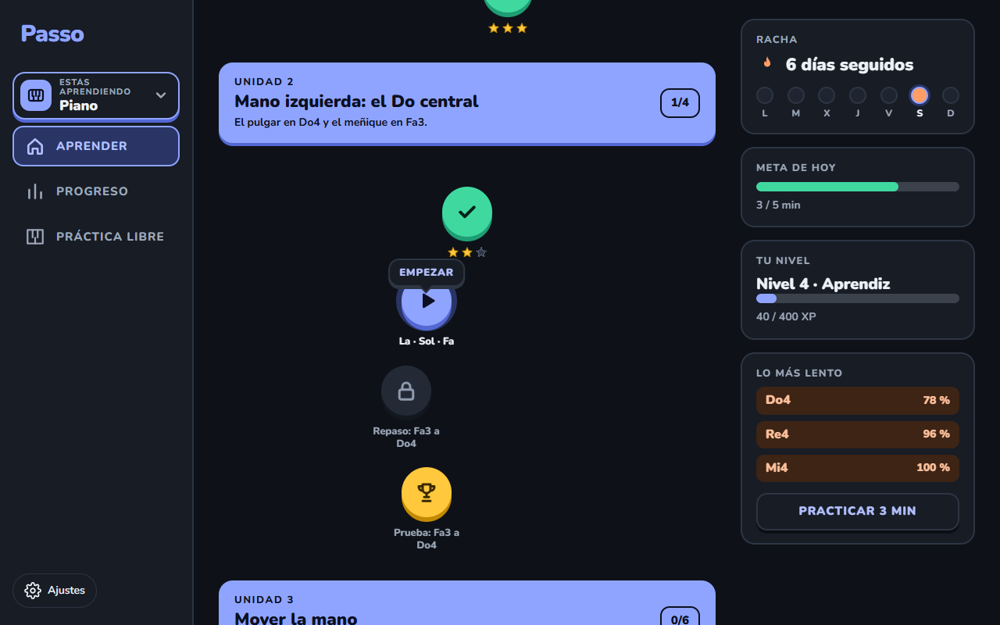
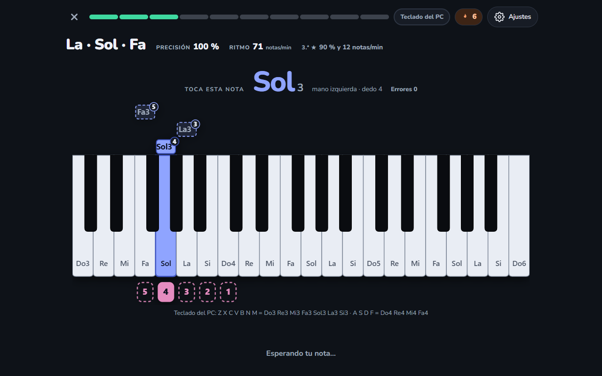
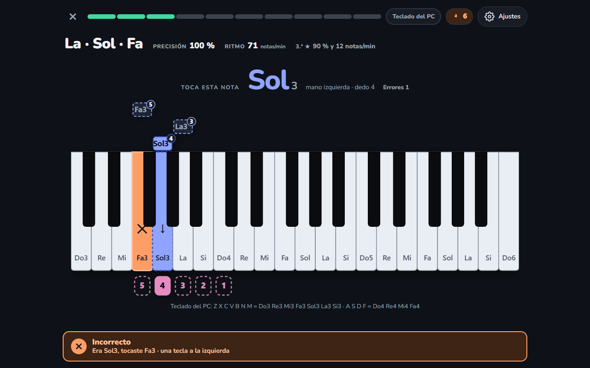
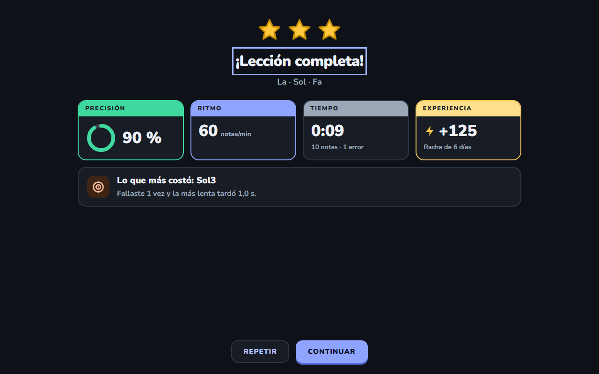
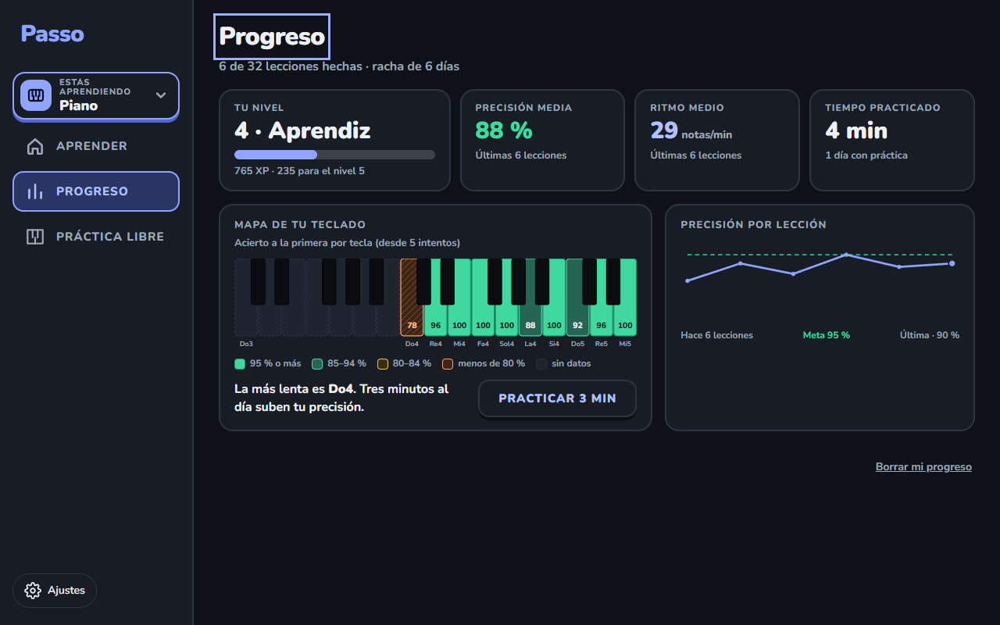
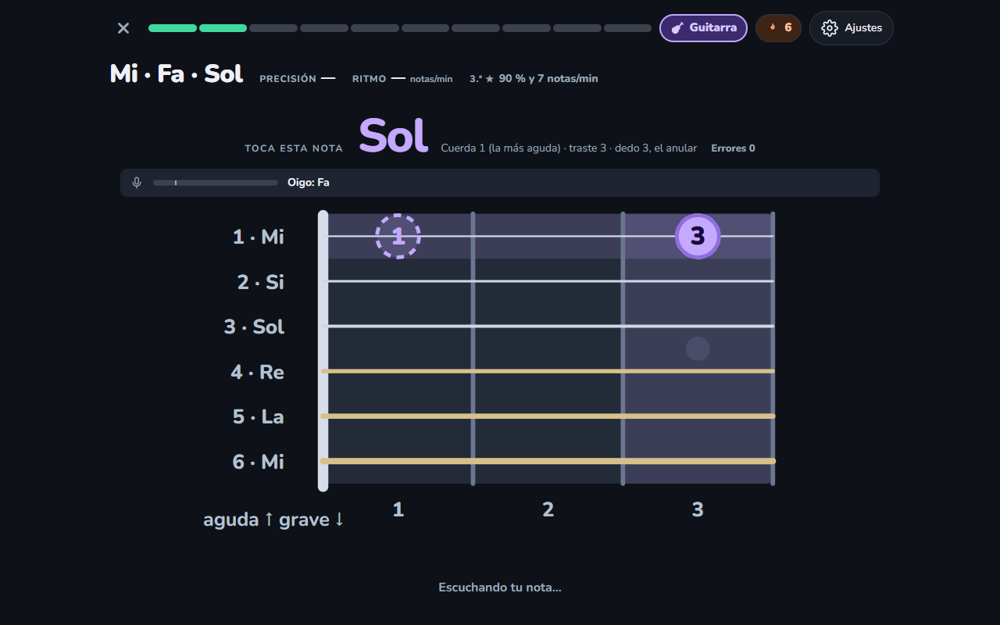
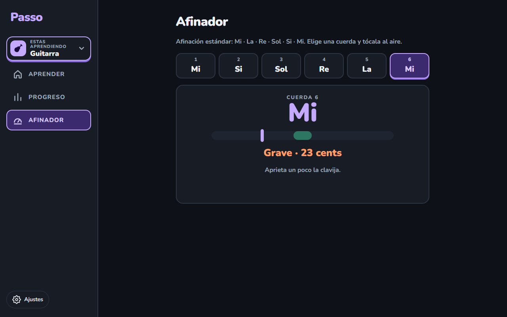

# Passo — Case study

> App web para aprender **piano y guitarra con corrección al instante**: tocas, Passo te escucha por el
> micrófono y te dice al momento qué salió bien y qué no. Proyecto personal, octubre de 2026.

`React 19` · `TypeScript` · `Vite` · `Clean Architecture` · `Web Audio` · `Web MIDI` · `Vitest` · `Playwright`

*Capturas de la propia aplicación, generadas por una prueba con un micrófono simulado.*

---

## El problema
Quien aprende un instrumento con videos y cursos termina tocando lo que ya sabe, y nadie le corrige en
el momento. Las apps que sí corrigen suelen exigir un piano con USB-MIDI o enviar el audio a un
servidor, y la mayoría trata todos los errores igual: no distingue si te equivocaste de tecla o si el
micrófono simplemente dudó.

## La solución
Passo muestra qué tocar, escucha, corrige al instante y lleva al estudiante a practicar justo lo que más
le cuesta:

- **🎹 Corrección inmediata.** Cada nota se evalúa al sonar: acierto, error (con «era Sol, tocaste Fa,
  una tecla a la izquierda») o duda del micrófono, que **no cuenta como error**.
- **🎙️ Con el instrumento que ya tienes.** El micrófono del portátil es la entrada principal; también
  funciona con piano MIDI y con el teclado del PC. El audio se analiza en el navegador: no se graba ni
  se envía.
- **🎮 Un juego, no un examen.** Camino de unidades y lecciones cortas, estrellas, experiencia, racha de
  días y meta diaria.
- **🎸 Dos instrumentos en una app.** Piano (6 unidades, 32 lecciones) y guitarra (3 unidades, 14
  lecciones, mástil y afinador), cada uno con su camino y su progreso.
- **🔁 Repaso de puntos débiles.** «Practicar 3 min» arma una lección al momento con las notas que más
  cuestan, y el mapa de calor del teclado muestra cuáles se te escapan.
- **📱 Cabe en 320 px** sin desplazamiento horizontal, y cumple contraste AA comprobado por pruebas.

## Capturas

| | |
|---|---|
|  |  |
| *Nota, mano, dedo, cascada y ritmo en vivo.* | *«Era Sol3, tocaste Fa3 · una tecla a la izquierda».* |
|  |  |
| *Estrellas, precisión y lo que más costó.* | *Mapa de calor del teclado y curva de precisión.* |
|  |  |
| *Mástil con cuerda, traste y dedo.* | *Afinador: «Grave · 22 cents».* |

## Decisiones técnicas destacadas
- **Escucha activa, no solo detección de tono.** La entrada por micrófono recorre una tubería propia:
  energía y ataque por fotograma → detección de tono McLeod (implementación propia) → rastreador de
  notas con confirmación, octava y afinación aprendida → evento de nota con grado de seguridad. Una
  nota dudosa nunca cuenta como error.
- **Clean Architecture comprobada por herramientas.** Dominio en TypeScript puro (sin DOM, reloj ni
  azar propio), casos de uso, puertos (`NoteInput`, `Clock`, `ProgressStore`…) y adaptadores
  intercambiables. `dependency-cruiser` y ESLint rechazan los imports que rompan las capas. Por eso
  micrófono, MIDI y teclado del PC son la misma interfaz, y en pruebas se sustituyen por falsos.
- **Se juzga el nombre de la nota, no la octava,** en guitarra: se escribe una octava por encima de
  como suena y el micrófono lee mal las cuerdas graves. El mástil indica dónde tocarla.
- **El progreso se deriva, no se guarda.** Qué lecciones están abiertas sale de las estrellas. Los
  datos viven en `localStorage`, versionados: lo dañado o de una versión nueva nunca rompe la app ni se
  sobrescribe.
- **Privado y sin servidor.** Sin cuentas, sin nube, sin anuncios. Dependencias de ejecución: solo
  React y la tipografía Nunito, autoalojada.
- **Pruebas con audio sintético.** Una guitarra Karplus-Strong y tonos de piano por osciladores
  alimentan el micrófono simulado, así que las pruebas de extremo a extremo son deterministas y las
  capturas del README se regeneran con un comando.
- **Método por fases.** Una fase a la vez, con plan, revisión desde tres perfiles (música y pedagogía,
  interfaz y experiencia, arquitectura; agentes de IA), commits pequeños, evidencias en video y cierre.

## Números del repositorio
~13.800 líneas de código y ~18.600 de pruebas (TypeScript) · 1.375 pruebas unitarias, de integración y
de interfaz en 77 archivos · 58 pruebas de extremo a extremo en Edge · 166 commits en 19 días
(13–31 de octubre de 2026).

## Resultado
Fases 0 a 3 y la etapa 1 de guitarra completadas: escucha por micrófono, ajustes, terceras y acordes,
juego con camino, estrellas, racha y progreso, y guitarra con mástil y afinador. Cada fase cerrada
deja su informe, su video y sus capturas.

**Lo que falta, dicho claro:** todo el audio de las pruebas es sintético. Los umbrales del afinador y de
las cuerdas graves salen de simulaciones y están por confirmar con un piano y una guitarra reales.
Pendientes: arpegios y acordes de guitarra, tablatura, canciones compás a compás y el motor adaptativo
de práctica por tramos.

## Mi rol
Proyecto personal hecho por mí de principio a fin: producto y alcance de cada fase, arquitectura,
procesamiento de audio, interfaz, pruebas y documentación, trabajando con un asistente de IA bajo un
método y unas convenciones escritas.

---

> El código es público: [KevinHGitCode/Passo](https://github.com/KevinHGitCode/Passo). La guía para
> correrlo está en el [README](../README.md).

**Contacto:** [GitHub](https://github.com/KevinHGitCode) · kevinhafiddiazgarcia@gmail.com
